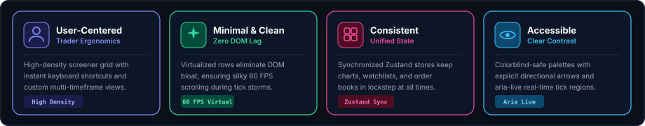
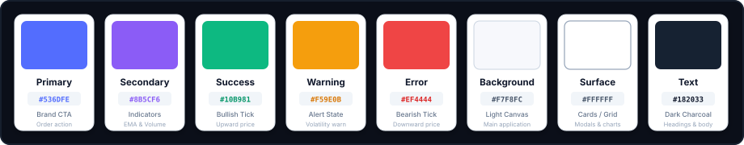

# Design System
### EquityPulse — Clean. Simple. Productive.

  

This document defines the visual design system, UI components, design tokens, and user experience standards for the **EquityPulse** financial market screener. The goal is to establish an ultra-modern, high-density, low-latency interface with consistent styling across the virtualized screener grid, watchlist docks, and TradingView charts.

---

### 1. Design Principles

  

---

### 2. Color Palette
*Primary colors used across the screener, candlestick charts, and telemetry interfaces:*

  

---

### 3. Typography
*We use Inter as the primary interface font and JetBrains Mono for prices, percentages, and trade executions:*

  <table width="100%" cellpadding="0" cellspacing="0" border="0">
    <tr>
      <td width="90" align="center" style="font-size: 40px; font-weight: 800; background-color: #161B22; color: #818CF8; border: 1px solid #30363D; border-radius: 8px; padding: 8px 12px;">Aa</td>
      <td style="padding-left: 20px;">
        
Inter &amp; JetBrains Mono

        
Primary font family

        
Clean, modern, and highly legible across financial data tables, tick charts, and order tickets.

      </td>
    </tr>
  </table>

| Role | Font Family | Size / Weight | Usage |
| :-- | :-- | :-- | :-- |
| **Header 1** | Inter | 22px / 700 Bold | App header, primary market summary stats |
| **Header 2** | Inter | 16px / 600 Semi-Bold | Section titles, chart symbol headers |
| **Table Header** | Inter | 12px / 600 Semi-Bold | Screener column labels (Symbol, Price, Change) |
| **Financial Monospace** | JetBrains Mono | 13px / 600 Semi-Bold | Ticker prices, percentages, market cap figures |

---

### 4. UI Components & Visual Tokens

#### 4.1 Price Movement Badges

| State | Background | Text Color | Border | Meaning |
| :-- | :-- | :-- | :-- | :-- |
| **BULLISH / UPTICK** | `#ECFDF5` | `#059669` | `1px solid #A7F3D0` | Positive price change / green flash |
| **BEARISH / DOWNTICK** | `#FEF2F2` | `#DC2626` | `1px solid #FECACA` | Negative price change / red flash |
| **NEUTRAL** | `#F1F5F9` | `#475569` | `1px solid #CBD5E1` | Unchanged price state |

#### 4.2 Real-Time Tick Flash Card

  

    

      Active Instrument
      
NVDA &bull; NVIDIA Corporation

    

    

      $138.25 (+3.42%) ▲
      
Volume: <code style="color: #818CF8;">42.8M</code> &bull; 60 FPS Stream

    

  

